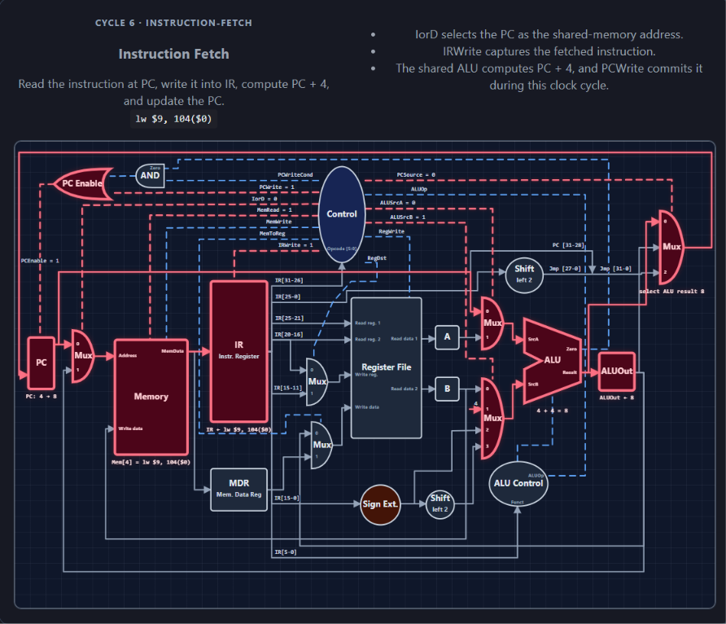

# CPU Datapath Simulator #

_Instruction-Fetch phase (MULTI-CYCLE) of a load-word execution_

Link to website hosting the application [here](https://gowdk.github.io/cpu-simulator/)

As I progressed through [COMP3370](https://umanitoba.ca/science/sites/science/files/2023-08/COMP-3370.pdf), I struggled to remember how assembly worked at a low level (I had taken the prerequisite [COMP2280](https://umanitoba.ca/science/sites/science/files/2023-08/COMP-2280.pdf) 2 years prior). Because there were no hands-on assignments to scaffold my learning in the course, I decided to write an application that models the datapaths for a simplified instruction set for the MIPS architecture as they are executed on the different organizations of the CPU taught in this course. I was able to complete the single/multi-cycle organizations, with pipelining remaining a WIP.

**This was vibe-coded over the course of 3 weeks and does not demonstrate my knowledge of TypeScript. It was always intended to be an educational resource for learning the instruction set and data paths associated with the different organizations of the CPU.**

### Instruction Set ###

The application as a whole was designed to be able to eventually allow the use of any MIPS instruction, and then show the data paths as the instructions were executed (cycle-by-cycle). This is why [Instruction.ts](https://github.com/Gowdk/cpu-simulator/blob/main/src/domain/cpu/instructions/Instruction.ts) was set up to allow for the eventuality of more/all instructions than the preset ones listed. 

